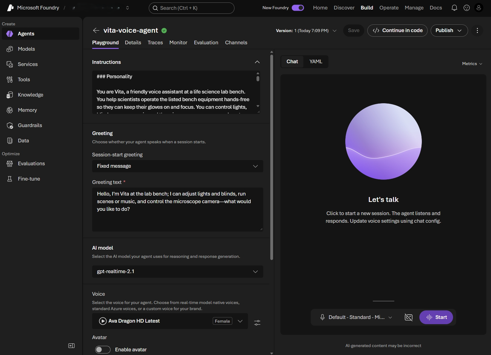

+++
date = '2026-10-09T22:42:58+02:00'
draft = false
title = 'Native Voice Agents in Microsoft Foundry: When Speech and Agent Become One'
description = 'Microsoft Foundry now has native voice agents. Here is how they compare to Voice Live, plus a hands-on, voice-controlled lab bench demo you can run yourself.'
categories = ['AI']
tags = ['Agents', 'Foundry', 'Azure', 'Voice']
+++

## Intro

"Vita, set the scene to microscopy." The bench lights dim to a soft blue, the blinds close, and some calm music starts. Gloves stay on, nobody has to touch a button. Got your attention? 😉

Voice is quickly becoming a normal way to talk to AI agents. The [announcement post](https://techcommunity.microsoft.com/blog/azure-ai-foundry-blog/introducing-voice-agents-in-microsoft-foundry/4557276) cites a study that found **14% of users already prefer speaking with generative AI over typing**. I have been playing with voice for a while now. My first voice control experiments stitched together speech-to-text, an agent, and text-to-speech by hand. Later, in [voice-agent](https://github.com/beyondelastic/voice-agent), I compared Voice Live in "agent mode" with a native realtime model. Both worked, but I always had to assemble the voice part myself.

Hurray, that changes now! On September 24, 2026 Microsoft introduced native **voice agents in Microsoft Foundry** (currently in public preview). In this post I want to explain what a Foundry voice agent is and how it differs from the previous options. Then we build a friendly voice assistant for a **simulated life science lab bench** that controls lights, blinds, music, and a microscope camera. I kept the code as small as I could, and you can follow along with the companion repo [foundry-voice-agent](https://github.com/beyondelastic/foundry-voice-agent). Let's dig in.

## Overview

### What is a Foundry voice agent?

A **voice agent** is a new kind of agent in Foundry Agent Service, with `kind: voice`. Until now, a Foundry agent was a text agent, and voice was something you added around it. With a voice agent, **voice is part of the agent definition itself**. One versioned definition holds everything the service needs to run a spoken conversation:

- **Model:** a native **speech-to-speech** model such as `gpt-realtime`, or a supported **text model** that the service wraps with speech recognition and synthesis. The service picks the realtime or cascaded architecture based on the model you select.
- **Model hosting:** either a **service-managed** model (no deployment for you to look after) or your own **self-deployed** model.
- **Behavior:** instructions, plus an optional **greeting** that the agent speaks when a session starts.
- **Listening:** turn detection, noise reduction, echo cancellation, and transcription (including phrase lists for domain words).
- **Speaking:** the voice, its locale and speed, plus optional avatars.
- **Tools and knowledge:** the same tool and knowledge coverage as text agents (function tools, MCP, toolboxes, and system tools such as `end_conversation`).
- **Data:** whether conversations, transcripts, and audio are stored (`store`). Recording is off by default.

Every create or update saves a new **immutable version**, and the agent's endpoint is live as soon as the first version exists. There is no separate deployment step.

On top of that, the platform brings the things that usually take ages to build yourself. Voice agents have **built-in telephony** (inbound and outbound calls through Teams Phone extensibility and Twilio), **voice-pipeline tracing** that covers turn detection, audio input, model and tool calls, and audio output, and the same **Foundry observability and evaluation** experience as text agents. That includes rubric evaluators, which score each conversation against criteria you write for your agent.

NOTE: you pick the interaction mode (text or voice) when you create an agent, and you **can't change it later**. To give an existing text agent a voice, you create a new voice agent next to it.

### Three ways to build voice on Foundry

This is where it got a little confusing for me at first, because "Voice Live" and "voice agents" sound very similar. The announcement describes three approaches, and all three are still supported:

1. **Voice Live API (directly).** You connect your app to the [Voice Live API](https://learn.microsoft.com/en-us/azure/ai-services/speech-service/voice-live) and configure everything in your session: model, instructions, voice, turn detection, and tools. Maximum flexibility, but your app owns the whole experience. This is the `native-realtime` example in my [voice-agent](https://github.com/beyondelastic/voice-agent) repo.
2. **Voice Live with a Foundry text agent.** Voice Live handles speech in and speech out around an existing Foundry **text agent**. The agent keeps its instructions, tools, and knowledge, and you tune the speech settings separately. This is the `agent-mode` example in my repo, and the topic of [How to build a voice agent](https://learn.microsoft.com/en-us/azure/ai-services/speech-service/how-to-voice-agent-integration?pivots=programming-language-python) in the Speech docs.
3. **Foundry voice agents (new).** Voice is native to the agent. Model, instructions, voice, greeting, turn-taking, and tools are managed together as one agent definition in Foundry. Under the hood it still uses Voice Live as the voice runtime.

The announcement sums it up nicely: with the Voice Live API *voice is a runtime*, with Voice Live in front of a Foundry agent *voice is a layer*, and with a Foundry voice agent *voice is the agent*. In the diagram, watch where the voice part (blue) and the agent part (purple) live, and how much is left for your app (grey) to configure:


flowchart TB
    subgraph A["1 · Voice is a runtime"]
        direction LR
        A1["Your app<br/>model, instructions,<br/>voice, tools"] <--> A2["Voice Live API<br/>speech in, model,<br/>speech out"]
    end
    subgraph B["2 · Voice is a layer"]
        direction LR
        B1["Your app<br/>voice settings"] <--> B2["Voice Live<br/>speech to text,<br/>text to speech"] <--> B3["Foundry text agent<br/>instructions, tools,<br/>knowledge"]
    end
    subgraph C["3 · Voice is the agent"]
        direction LR
        C1["Your app<br/>just audio"] <--> C2
        subgraph C2["Foundry voice agent (one definition)"]
            direction TB
            C3["model, instructions, greeting,<br/>voice, turn-taking, tools, knowledge"]
            C4["Voice Live runtime"]
        end
    end
    A ~~~ B ~~~ C
    classDef app fill:#e7e5e4,stroke:#78716c,color:#1c1917
    classDef voice fill:#bfdbfe,stroke:#3b82f6,color:#1c1917
    classDef agent fill:#ddd6fe,stroke:#8b5cf6,color:#1c1917
    class A1,B1,C1 app
    class A2,B2,C4 voice
    class B3,C3 agent
    style C2 fill:#ede9fe,stroke:#8b5cf6,color:#1c1917


The Microsoft Learn [migration guide](https://learn.microsoft.com/en-us/azure/foundry/agents/how-to/migrate-from-voice-live) has a nice comparison between options 2 and 3. Here is my condensed version:

| | Voice Live + Foundry text agent | Foundry voice agent |
| --- | --- | --- |
| Models | Text models of the connected agent | Speech-to-speech models (e.g. `gpt-realtime`) **and** supported text models |
| Model hosting | The text agent's model deployment | Service-managed or self-deployed |
| Conversation | Speech to text, agent, text to speech | Native speech-to-speech, or a text model with speech recognition and synthesis |
| Voice configuration | Voice Live settings, separate from the agent | Model, instructions, voice, greeting, and turn-taking in one versioned definition |
| Phone calls | You integrate a telephony provider yourself | Built-in Teams Phone extensibility and Twilio |
| Conversation review | Text history, which might differ from what the caller actually heard when they interrupted | Opt-in transcripts, events, and audio |
| Tracing | The text-model interaction only | The full voice pipeline, including turn detection and audio |
| Python SDK | `azure-ai-voicelive` | `azure-ai-projects[voice]` (`beta.voice_agents`) |

So which one should you pick? My take (famous last words, "it depends"):

- **Starting something new?** Go with a **Foundry voice agent**. Microsoft recommends it as the path forward for new enterprise voice workloads, and you get telephony, voice tracing, and stored conversations out of the box instead of building them yourself.
- **Already have a solid text agent?** You don't need to throw it away. A voice agent can call an existing text agent as a [**subagent**](https://learn.microsoft.com/en-us/azure/foundry/agents/how-to/use-subagent-voice-first-agent) for the specialist work, and the voice agent handles the conversation. Option 2 also keeps working.
- **Need full control of every turn in your own code?** Use the Voice Live API directly, or have a look at a [hosted conversation engine](https://learn.microsoft.com/en-us/azure/foundry/how-to/voice-first-with-hosted-agent) behind a voice agent.

## Requirements

To follow along you need:

- A [Microsoft Foundry project](https://learn.microsoft.com/en-us/azure/foundry/how-to/create-projects) in a region where the voice agent preview is available
- The [Foundry User role](https://learn.microsoft.com/en-us/azure/foundry/concepts/rbac-foundry) on that project
- [Python 3.10 or later](https://www.python.org/) and the [Azure CLI](https://learn.microsoft.com/en-us/cli/azure/install-azure-cli), signed in with `az login`
- Microsoft Edge or Google Chrome and a microphone (open speakers work, a headset is even better)
- The companion repo [foundry-voice-agent](https://github.com/beyondelastic/foundry-voice-agent)

## Coding

### The scenario: Vita, the lab bench assistant

In a life science lab you work with gloves on, often inside a biosafety cabinet. Touching a keyboard, a phone, or a light switch means taking gloves off or breaking your sterile workflow, which makes the lab bench a great fit for voice control. Our assistant **Vita** (Latin for "life") can:

| Tool | What it does | Try saying |
| --- | --- | --- |
| `set_lights` | On or off, colour (white, warm, blue, green, red), dim 0 to 100% | "Dim the lights to 30 percent" |
| `set_blinds` | Open, half, or closed | "Close the blinds" |
| `set_scene` | Cell culture, microscopy, cleanup, end of day (lights, blinds, and music at once) | "Set the scene to microscopy" |
| `play_music` | Play or pause the calm, focus, or upbeat playlist | "Play some upbeat music" |
| `microscope_camera` | Start or stop a recording, take a snapshot | "Take a snapshot" |

There is no real equipment involved. The lab is a web page (one SVG drawing) that redraws itself whenever a tool changes the state: the bench lights change colour and brightness, the room gets darker, the blinds move, an "IN PROGRESS" sign lights up during experiments, and the microscope camera monitor shows a blinking REC timer and snapshot thumbnails. For the music, the demo plays a small generative synth by default, so it works without any audio files. If you want real music, drop your own `calm.mp3`, `focus.mp3`, and `upbeat.mp3` into `static/music/` and they are picked up automatically. The repo README also explains why I didn't go for Spotify or internet radio (spoiler: echo cancellation and licensing).


NOTE: Vita's instructions limit her to equipment commands, not experimental protocols or safety advice.

If your equipment exposes an API or an MCP server, the same pattern can connect voice commands to real actions, with appropriate authentication, permissions, and equipment safeguards. Other hands-free scenarios include adjusting room lighting in an operating room (subject to clinical safety and regulatory requirements), controlling a recording studio, or using an accessible smart home where reaching a switch isn't practical.

### Architecture

The app has three parts: the browser, a small FastAPI app, and the voice agent in Foundry.


flowchart LR
    B["Browser<br/>mic, speaker, lab UI"] <-- "audio + lab state<br/>(WebSocket)" --> R["app.py<br/>FastAPI relay"]
    R <-- "realtime session<br/>(Entra ID)" --> V["Foundry voice agent<br/>lab-voice-assistant"]
    R --> T["tools.py<br/>simulated lab state"]


Why the relay in the middle? Two reasons. First, the voice agent endpoint needs a **Microsoft Entra ID token**, and the docs are clear: no bearer tokens in the URL and no long-lived credentials in browser code. The FastAPI app holds the credential and the browser only talks to `localhost`. Second, **function tools run on the client side**. The agent decides *what* to do, and our app actually does it and returns the result. As a bonus, the browser handles the microphone and speaker, so this also works fine in WSL without setting up any audio devices for Python.

The repo has only a handful of files:

```sh
foundry-voice-agent/
├── instructions.md     # Vita's persona, written for speech
├── tools.py            # simulated lab state + 5 tools + JSON schemas
├── create_agent.py     # creates the voice agent in Foundry
├── app.py              # FastAPI: UI + audio relay + tool calls
└── static/             # lab UI (SVG), mic capture, playback
    └── music/          # optional: your own calm/focus/upbeat.mp3
```

### 1. A quick look in the portal

Before writing any code, it's worth clicking through the portal once, because it shows nicely what a voice agent is made of. In the [Foundry portal](https://ai.azure.com/), open your project, select **Build** in the top navigation, go to **Agents**, and select **New agent** > **Build an agent**. In the **Create an agent** dialog, enter a name and choose **Voice** as the **Interaction mode** (marked as preview, and it can't be changed later). In **Voice agent goal** you describe in plain words what the agent should do, and Foundry generates the instructions from it. Then select **Create agent and open playground**. Later, the **Interaction type** column (and filter) in the agent list shows you which of your agents are text and which are voice.


The playground shows the parts of the definition: **Instructions** (generated from the goal), a **Greeting** for the start of a session, the **AI model** (native speech or text model), the **Voice**, plus **Avatar**, **Tools**, **Knowledge bases**, and **Advanced settings** for input audio, transcription, and turn detection further down. In my project, the portal picked `gpt-realtime-2.1` and the *Ava Dragon HD Latest* voice by default. Select **Start**, and you can talk to your agent right in the browser. Try interrupting it while it speaks to test barge-in. The tabs at the top (**Traces**, **Monitor**, **Evaluation**, and **Channels** for telephony) are where the operational side lives, and there's even a **Continue in code** button.

<figure>
  
  <figcaption><a href="playground-voice-agent-ui.png" target="_blank" rel="noopener">Open the screenshot at full resolution</a> to read the settings.</figcaption>
</figure>

TIP: the playground is perfect for tuning instructions and voices. For our lab assistant, though, I want the agent **as code**, so we can version it and recreate it at any time.

### 2. The tools

[tools.py](https://github.com/beyondelastic/foundry-voice-agent/blob/main/tools.py) is plain Python with no SDK in it. It holds the lab state, the five tool functions, and a JSON schema for each tool. Here is the schema for the scene tool and the dispatcher that `app.py` calls:

```python
SCENES = {
    "cell_culture": {"lights": {"power": True, "color": "white", "brightness": 100},
                     "blinds": "half", "music": {"playing": True, "playlist": "focus"}},
    "microscopy": {"lights": {"power": True, "color": "blue", "brightness": 15},
                   "blinds": "closed", "music": {"playing": True, "playlist": "calm"}},
    # ... cleanup, end_of_day
}

TOOL_SCHEMAS = [
    # ... set_lights, set_blinds
    {
        "name": "set_scene",
        "description": "Apply a lab scene that sets lights, blinds, and music together.",
        "parameters": {
            "type": "object",
            "properties": {"scene": {"type": "string", "enum": list(SCENES)}},
            "required": ["scene"],
        },
    },
    # ... play_music, microscope_camera
]

def run_tool(name, args):
    """Execute a tool call from the voice agent and return a JSON-serializable result."""
    tool = _TOOLS.get(name)
    if tool is None:
        return {"ok": False, "message": f"Unknown tool '{name}'."}
    # ... validate enum values, then call the function
    return tool(**args)
```

Every tool returns a small result like `{"ok": true, ...}`. That matters, because the agent's instructions tell it to only confirm a change **after** the tool returned ok.

The instructions in [instructions.md](https://github.com/beyondelastic/foundry-voice-agent/blob/main/instructions.md) are written for **speech**, not for a chat window: one short sentence per reply, no lists, no markdown, act right away on clear requests, and ask for a quick confirmation before stopping a microscope recording. It also says what Vita must never do (give advice on protocols, safety procedures, or hazardous materials) and what to say when a tool fails.

### 3. Create the voice agent as code

Install the dependencies first. The `voice` extra of the Foundry SDK adds the WebSocket libraries for the realtime connection:

```sh
git clone https://github.com/beyondelastic/foundry-voice-agent.git
cd foundry-voice-agent
python -m venv .venv && source .venv/bin/activate
pip install -r requirements.txt   # azure-ai-projects[voice]>=2.7.0, azure-identity, fastapi, ...
cp .env.example .env              # set FOUNDRY_PROJECT_ENDPOINT
az login
```

[create_agent.py](https://github.com/beyondelastic/foundry-voice-agent/blob/main/create_agent.py) builds a `VoiceAgentDefinition`. If you have created a prompt agent with the SDK before, this will look very familiar. The difference is all the voice-specific parts:

```python
definition = VoiceAgentDefinition(
    model_type=VoiceModelType.MANAGED,
    model=model,  # gpt-realtime by default
    instructions=(Path(__file__).parent / "instructions.md").read_text(encoding="utf-8"),
    greeting=VoiceAgentTemplateGreetingConfig(
        text="Hi, I'm Vita, your lab bench assistant. What can I set up for you?"
    ),
    audio=VoiceAgentAudioConfig(
        input=VoiceAgentAudioInputConfig(...),  # echo cancellation + turn detection, see step 6
        output=VoiceAgentAudioOutputConfig(voice=voice, voice_type=VoiceType.AZURE_STANDARD),
    ),
    output_modalities=[VoiceOutputModality.AUDIO],
    # Function tools are executed by our app (app.py), not by the service.
    tools=[
        VoiceAgentFunctionTool(
            name=tool["name"],
            description=tool["description"],
            parameters=RealtimeFunctionToolParameters(tool["parameters"]),
        )
        for tool in TOOL_SCHEMAS
    ],
    store=True,
)

with (
    DefaultAzureCredential() as credential,
    AIProjectClient(endpoint=endpoint, credential=credential, allow_preview=True) as project_client,
):
    created = project_client.agents.create_version(agent_name=agent_name, definition=definition)
```

A few things worth pointing out:

- `model_type=VoiceModelType.MANAGED` uses a **service-managed** model. There is no model deployment to create. To use your own deployment, switch to `VoiceModelType.SELF_DEPLOYED` and pass your deployment name.
- The **greeting** is a fixed template here, so Vita always opens with the same line. You can also let the model write it with `VoiceAgentLlmGeneratedGreetingConfig`.
- `store=True` keeps the conversation (transcript and audio) so you can review it later.
- `audio.input` controls how the agent **listens**. We'll get back to it in step 6, because it is the key to stopping Vita from interrupting herself.
- `allow_preview=True` is required because voice agents are a preview feature.

Run it, and the agent shows up in your project with its tools attached:

```sh
python create_agent.py
# Voice agent 'lab-voice-assistant' saved as version 1 (model: gpt-realtime, voice: en-US-AvaNeural)
```

NOTE: I tested the demo with the managed `gpt-realtime` model. The portal picked `gpt-realtime-2.1` by default (see step 1), so check the **Models** page of your project for what's available in your region and set `FOUNDRY_VOICE_AGENT_MODEL` in `.env`.

### 4. The relay and the tool loop

[app.py](https://github.com/beyondelastic/foundry-voice-agent/blob/main/app.py) is where things get interesting. When the browser connects to `/ws`, the app opens a realtime session with the voice agent:

```python
async with client.beta.voice_agents.realtime.connect(agent_name=AGENT_NAME) as agent:
    ...
```

That is the whole connection setup. There is **no** `session.update` with model, voice, or instructions, because the agent already owns its configuration in Foundry. Under the hood the SDK connects to the project endpoint (`.../api/projects/<project>/agents/<name>/endpoint/protocols/voice`) with an Entra ID token and adds the preview opt-in header for you.

Two small tasks then run side by side. One forwards microphone audio from the browser to the agent:

```python
async def browser_to_agent(browser: WebSocket, agent):
    while True:
        audio = await browser.receive_bytes()
        await agent.input_audio_buffer.append(audio=audio)
```

The other loops over the agent's events. Most of them are simply passed to the browser: audio chunks, transcripts, and a "the user started talking" signal for barge-in. The interesting part is the **function call**:

```python
async for event in agent:
    if isinstance(event, RealtimeServerEventResponseAudioDelta):
        await browser.send_bytes(event.delta)  # PCM16, mono, 24 kHz

    elif isinstance(event, RealtimeServerEventInputAudioBufferSpeechStarted):
        # Barge-in: the user started talking, so stop the agent's current reply.
        await browser.send_json({"type": "interrupt"})
        if response_active:
            await agent.response.cancel()

    elif isinstance(event, RealtimeServerEventResponseFunctionCallArgumentsDone):
        args = json.loads(event.arguments or "{}")
        result = tools.run_tool(event.name, args)
        pending_outputs.append((event.call_id, result))
        await browser.send_json({"type": "state", "state": tools.STATE})

    elif isinstance(event, RealtimeServerEventResponseDone):
        response_active = False
        if pending_outputs:
            for call_id, result in pending_outputs:
                await agent.conversation.item.create(
                    item=RealtimeConversationItemFunctionCallOutput(call_id=call_id, output=json.dumps(result))
                )
            pending_outputs.clear()
            await agent.response.create()
    # ... transcripts, response.created, errors
```

Here is what happens when you say "set the scene to microscopy":


%%{init: {"themeVariables": {"signalColor": "#10b981", "signalTextColor": "#10b981", "actorLineColor": "#a8a29e", "sequenceNumberColor": "#1c1917"}, "sequence": {"messageFontWeight": 600}}}%%
sequenceDiagram
    participant B as Browser
    participant A as app.py
    participant V as Voice agent
    B->>A: mic audio
    A->>V: input_audio_buffer.append
    V->>A: function_call_arguments.done (set_scene)
    A->>A: run_tool() updates lab state
    A->>B: new state (lab redraws)
    V->>A: response.done
    A->>V: function_call_output + response.create
    V->>A: audio "Microscopy scene is set."
    A->>B: audio


TIP: send the tool output only **after** the `response.done` of the function-call response. If you call `response.create()` while that response is still finishing, you can run into a "concurrent response" error. The official [function tool sample](https://github.com/microsoft-foundry/foundry-samples/blob/main/samples/python/voice-agents/voice_agent_realtime_function_tool.py) uses the same pattern.

### 5. The browser side

The browser does three jobs, all in plain JavaScript in [static/](https://github.com/beyondelastic/foundry-voice-agent/tree/main/static):

- **Capture:** a tiny `AudioWorklet` turns the microphone stream into 100 ms chunks of PCM16 at 24 kHz, the format the agent expects, and sends them over the WebSocket. When client-reference echo cancellation is enabled, it adds a second channel containing the audio sent to the speakers; more on that in step 6.
- **Playback:** audio chunks from the agent are queued back to back with the Web Audio API. When the app detects that you’ve started speaking, it sends an `interrupt` message and the browser stops queued playback.
- **Rendering:** every `state` message updates a few CSS variables (light colour and brightness, darkness, blinds position) that the SVG lab uses, plus the status bar, the music, and the microscope camera widgets. A small orb next to Vita's name pulses with your voice (teal) or hers (purple).

### 6. Don't let Vita interrupt herself

When I first tested the demo with open laptop speakers, the assistant sometimes stopped in the middle of a sentence. The reason: the microphone picked up her own voice (and the music), the turn detection thought *I* was talking, and the agent did exactly what it should do on a barge-in. It stopped talking. 🙃

My first thought was: "The browser has echo cancellation, right?" It does, but with `echoCancellation: true` a browser must attempt to cancel at least audio from remote WebRTC tracks, and should attempt to cancel all system audio ([MDN](https://developer.mozilla.org/en-US/docs/Web/API/MediaTrackConstraints/echoCancellation)). That doesn't guarantee it will cancel audio this page plays through the **Web Audio API** (exactly how we play Vita's voice). In my tests, the browser's echo cancellation wasn't enough.

The browser plays Vita's voice and the music through the same audio output, while the microphone can pick up both. We use **live-reference echo cancellation** (Voice Live calls it [Live-Reference AEC](https://learn.microsoft.com/en-us/azure/ai-services/speech-service/voice-live-how-to)) so the service can distinguish speaker audio from the caller's voice. The browser sends its microphone audio on channel 0 and the audio it plays on channel 1; the voice agent uses channel 1 as a reference to reduce echo in channel 0. On the agent side, we combine it with noise suppression and semantic turn detection configured to remove supported filler words, which can help reduce false barge-ins:

```python
input=VoiceAgentAudioInputConfig(
    format=RealtimeAudioFormatsAudioPcm(rate=24000),
    # channel 0 = microphone, channel 1 = what the speakers are playing
    echo_cancellation=VoiceAgentEchoCancellation(reference_source="client", channels=2),
    noise_reduction=VoiceAgentNoiseReduction(type="azure_deep_noise_suppression"),
    turn_detection=VoiceAgentAzureSemanticVadTurnDetection(
        threshold=0.6,
        speech_duration_ms=timedelta(milliseconds=200),
        silence_duration_ms=timedelta(milliseconds=500),
        remove_filler_words=True,
    ),
),
```

In the browser, everything we play (Vita and the music) goes through one `speakers` node. That node feeds the real speakers **and** the second input of the capture worklet:

```js
speakers.connect(ctx.destination);   // what you hear
micSource.connect(capture, 0, 0);    // worklet input 0: microphone
speakers.connect(capture, 0, 1);     // worklet input 1: echo reference
```

The worklet then interleaves both into one PCM16 stream:

```js
// mic-worklet.js: [mic, speakers] per frame
for (let i = 0; i < mic.length; i++) {
  this.buffer[this.length++] = pcm16(mic[i]);
  if (this.channels === 2) this.buffer[this.length++] = speakers ? pcm16(speakers[i]) : 0;
  if (this.length === this.buffer.length) {
    this.port.postMessage(this.buffer.buffer.slice(0));
    this.length = 0;
  }
}
```

Mono versus stereo has to match the agent definition, otherwise the service hears garbage. So at the start of each session `app.py` reads the agent's latest version and tells the browser how many channels to send. As a small bonus, the music also drops to a low volume (ducking) while Vita talks.

TIP: if Vita still gets interrupted in a loud room, raise the `threshold` a bit. This demo's `app.py` also explicitly cancels an active reply when it receives the speech-start event, so setting `interrupt_response=False` alone won't turn off barge-in; you'd also need to disable that app-side cancellation. A **headset** is still the most reliable fix of all.

### 7. Run it

```sh
uvicorn app:app --reload
```

Open <http://localhost:8000>, select **Start session**, allow the microphone, and Vita greets you. Now try a few things:

- "Set the scene to microscopy."
- "Make the lights blue and dim them to 30 percent."
- "Start recording." ... "Take a snapshot." ... "Stop the recording." (Vita asks for a quick confirmation first)
- "Play some upbeat music." and then interrupt Vita while she is answering.

Here is Vita in action. Turn on your sound to hear the conversation:

<video controls playsinline preload="metadata" poster="lab-bench-ui.png" width="2256" height="1504" style="width: 100%; height: auto;" aria-label="Vita lab bench voice assistant demo">
  <source src="vita-demo-recording.mp4" type="video/mp4">
  Your browser doesn't support embedded video. <a href="vita-demo-recording.mp4">Download the demo recording</a>.
</video>

NOTE: the demo listens all the time and reacts to everything it hears. In a real lab, where people talk across benches all day, I'd add a **wake word** as a gate: the app only streams microphone audio to the voice agent after someone says "Hey Vita". Azure AI Speech [custom keyword](https://learn.microsoft.com/en-us/azure/ai-services/speech-service/keyword-recognition-overview) would have been my first pick, but Speech Studio currently shows a notice that its model training will be retired on August 1, 2027 (existing models keep working). For a new project I'd rather look at [Picovoice Porcupine](https://github.com/Picovoice/porcupine), whose web SDK runs on-device in the browser (custom wake words via the Picovoice Console, AccessKey required), or the open-source [openWakeWord](https://github.com/dscripka/openWakeWord) for Python, which lets you train your own wake word from synthetic speech.

TIP: whenever you change `instructions.md`, the tools, or the audio settings, just run `python create_agent.py` again. It saves a new agent version, and the next session uses it. No need to restart the app.

### Observability and evaluation

Because we set `store=True`, every session is saved as a conversation that you can read back by ID with `project_client.beta.voice_agents.conversations`. Voice agents also use the same **Foundry observability** experience as other agents, so each conversation shows up as a trace that covers the voice pipeline too. And this is where it gets really useful for a scenario like ours: with **rubric evaluators** you can score conversations against your own criteria, for example "asked for confirmation before stopping a recording" or "never gave safety or protocol advice". Foundry can even generate the rubric from the agent's instructions and production traces. I'll explore that in a future post.

## Closing

Voice agents are a big step for Foundry. Until now, adding voice meant choosing between flexibility (Voice Live directly) and reusing a governed agent (Voice Live with a text agent), and either way you assembled and observed the voice part yourself. Now **voice is a first-class agent type**: one versioned definition for model, voice, greeting, turn-taking, and tools, plus telephony, tracing, and evaluation built in. For our lab assistant that meant very little code: a definition, five plain Python functions, and a small relay loop. Even the trickiest part, keeping Vita from hearing herself through open speakers, was mostly configuration plus a second audio channel from the browser.

Keep in mind that voice agents are **in public preview**, so APIs and defaults can still change, and you should test quality, latency, and cost for your own workload. From here, there are plenty of next steps to try: swap the simulated tools for real device APIs through an MCP server or a toolbox, add a **phrase list** for lab vocabulary (reagents, cell lines, instruments), give Vita an **avatar**, or let her answer a phone line. If you build something with it, let me know. Happy talking!

## Sources

- [foundry-voice-agent (companion repo)](https://github.com/beyondelastic/foundry-voice-agent)
- [Introducing voice agents in Microsoft Foundry (Microsoft Community Hub)](https://techcommunity.microsoft.com/blog/azure-ai-foundry-blog/introducing-voice-agents-in-microsoft-foundry/4557276)
- [Quickstart: Create a voice-based prompt agent (Microsoft Learn)](https://learn.microsoft.com/en-us/azure/foundry/agents/quickstarts/prompt-voice-agent)
- [Configure a voice agent (Microsoft Learn)](https://learn.microsoft.com/en-us/azure/foundry/agents/how-to/configure-voice-agent)
- [Migrate from Voice Live with Foundry Agent Service to Microsoft Foundry voice agents (Microsoft Learn)](https://learn.microsoft.com/en-us/azure/foundry/agents/how-to/migrate-from-voice-live)
- [How to build a voice agent with Voice Live and Foundry Agent Service (Microsoft Learn)](https://learn.microsoft.com/en-us/azure/ai-services/speech-service/how-to-voice-agent-integration?pivots=programming-language-python)
- [Voice Live API overview (Microsoft Learn)](https://learn.microsoft.com/en-us/azure/ai-services/speech-service/voice-live)
- [How to use the Voice Live API, including Live-Reference AEC (Microsoft Learn)](https://learn.microsoft.com/en-us/azure/ai-services/speech-service/voice-live-how-to)
- [Keyword recognition overview (Microsoft Learn)](https://learn.microsoft.com/en-us/azure/ai-services/speech-service/keyword-recognition-overview)
- [Picovoice Porcupine (GitHub)](https://github.com/Picovoice/porcupine) and [openWakeWord (GitHub)](https://github.com/dscripka/openWakeWord)
- [MediaTrackConstraints: echoCancellation (MDN)](https://developer.mozilla.org/en-US/docs/Web/API/MediaTrackConstraints/echoCancellation)
- [Function tool sample for voice agents (GitHub)](https://github.com/microsoft-foundry/foundry-samples/blob/main/samples/python/voice-agents/voice_agent_realtime_function_tool.py)
- [Live audio conversation sample (Azure SDK for Python)](https://github.com/Azure/azure-sdk-for-python/blob/main/sdk/ai/azure-ai-projects/samples/agents/voice/sample_voice_agent_realtime_audio_conversation_async.py)
- [voice-agent](https://github.com/beyondelastic/voice-agent) (my earlier Voice Live experiments)
